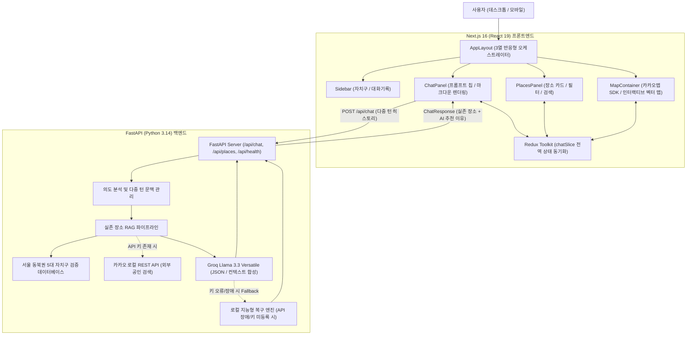

# 시스템 아키텍처 명세서 (ARCHITECTURE)

## 1. 아키텍처 개요
본 시스템은 Next.js 16 (React 19, Turbopack) 프론트엔드와 FastAPI (Python 3.14) 백엔드로 구성된 **하이브리드 AI 지역 탐색 플랫폼**입니다.
Groq Llama 3.3 LLM과 실존 장소 데이터셋(Ground Truth RAG) 및 카카오 로컬 REST API를 유기적으로 결합하여, AI의 환각(Hallucination)을 원천 차단하고 정밀한 인터랙티브 지도 탐색 경험을 제공합니다.



---

## 2. 프론트엔드 컴포넌트 아키텍처

```
frontend/
├── app/
│   ├── layout.tsx              # Noto Sans KR 폰트, 메타데이터, 다크 테마 루트
│   ├── page.tsx                # AppLayout 진입점
│   ├── globals.css             # CSS 변수 토큰, 글래스모피즘, 스크롤바
│   └── providers.tsx           # Redux Provider
├── components/
│   ├── layout/
│   │   ├── AppLayout.tsx       # 3-Column 데스크톱 및 모바일 탭 분기
│   │   ├── Sidebar.tsx         # 자치구 전환기, 새 대화, 최근 대화 세션
│   │   ├── Header.tsx          # 브랜드 로고, 지역 배지, 지도 토글
│   │   └── MobileNav.tsx       # 모바일 3단 탭 (대화, 장소, 지도)
│   ├── chat/
│   │   ├── ChatPanel.tsx       # 스마트 오토스크롤, API 통신, 하단 인디케이터
│   │   ├── ChatMessageItem.tsx # ReactMarkdown, 복사, 관련 장소 칩
│   │   ├── ChatInputArea.tsx   # 자동 높이 조절 textarea, 한글 IME 방어
│   │   ├── QuickPromptChips.tsx# 자치구별 실전 추천 질문 칩
│   │   └── ChatStatusIndicator.tsx # 3단계 실제 처리 상태 표시
│   ├── places/
│   │   ├── PlacesPanel.tsx     # 결과 내 검색, 카테고리 필터, 장소 목록
│   │   ├── PlaceCard.tsx       # 장소 카드, 카카오 길찾기, 상세 정보
│   │   ├── PlaceFilterBar.tsx  # 전체/맛집/카페/학원/문화시설 탭
│   │   └── PlaceDetailModal.tsx# 접근성 모달 (전화 걸기, 태그, 공식 링크)
│   ├── map/
│   │   ├── MapContainer.tsx    # 툴바 및 지도 래퍼
│   │   ├── KakaoMapView.tsx    # 카카오맵 SDK 동적 로더 및 마커 동기화
│   │   └── InteractiveMapFallback.tsx # 고해상도 GPS 벡터 지도 및 줌/팬
│   └── ui/                     # Button, Badge, Card, Modal, Skeleton
├── lib/
│   ├── types.ts                # TypeScript 데이터 모델
│   └── districtData.ts         # 5대 자치구 메타데이터 및 추천 프롬프트
└── store/
    ├── chatSlice.ts            # Redux 슬라이스 (양방향 동기화)
    └── store.ts                # Redux 스토어
```

---

## 3. 백엔드 데이터 및 RAG 흐름

### 3.1 요청 스키마 (`ChatRequest`)
```json
{
  "message": "노원구에서 조용한 스터디 카페 추천해 줘",
  "district": "노원구",
  "category": "카페",
  "history": [
    { "role": "user", "content": "..." },
    { "role": "assistant", "content": "..." }
  ]
}
```

### 3.2 응답 스키마 (`ChatResponse`)
```json
{
  "reply": "### 📍 [노원구] 추천 장소 안내\n...",
  "show_map": true,
  "places": [
    {
      "id": "nw-03",
      "name": "시드누아 노원본점",
      "district": "노원구",
      "category": "카페",
      "sub_category": "베이커리/디저트",
      "address": "서울 노원구 상계로 84",
      "road_address": "서울 노원구 상계동 341-6",
      "lat": 37.6575,
      "lng": 127.0645,
      "phone": "02-938-8959",
      "is_registered": true,
      "description": "노원역 인근 대형 베이커리 카페...",
      "tags": ["베이커리카페", "노원역", "분위기좋은"],
      "source": "검증된 지역 데이터베이스",
      "kakao_url": "https://place.map.kakao.com/26778931"
    }
  ],
  "district": "노원구",
  "is_demo": true,
  "status_message": "처리 완료 (검증된 지역 데이터베이스)"
}
```

---

## 4. 보안 및 신뢰성 아키텍처
1. **API 키 보호 및 마스킹**:
   - `backend_/.env` 및 클라이언트 환경 변수는 `.gitignore`에 등록되어 Git 원격 저장소 노출 차단.
   - 서버 시작 시 키의 앞/뒤 4자리만 로깅하고 민감 정보는 마스킹 처리(`gsk_...numr`).
2. **환각 억제 (Anti-Hallucination RAG)**:
   - LLM에게 임의의 장소와 주소를 생성하게 하지 않고, 사전 검증된 실존 데이터셋(또는 카카오 공인 검색 결과)을 프롬프트 주입(Prompt Injection Context)하여 실제 장소만을 근거로 추천.
3. **무중단 회귀 복구 (Graceful Fallback Engine)**:
   - Groq API 401 인증 실패, Rate Limit, 또는 네트워크 단절 시에도 서버가 500 에러를 뿜지 않고 로컬 지능형 엔진으로 자동 fallback하여 100% 서비스 가용성 보장.
