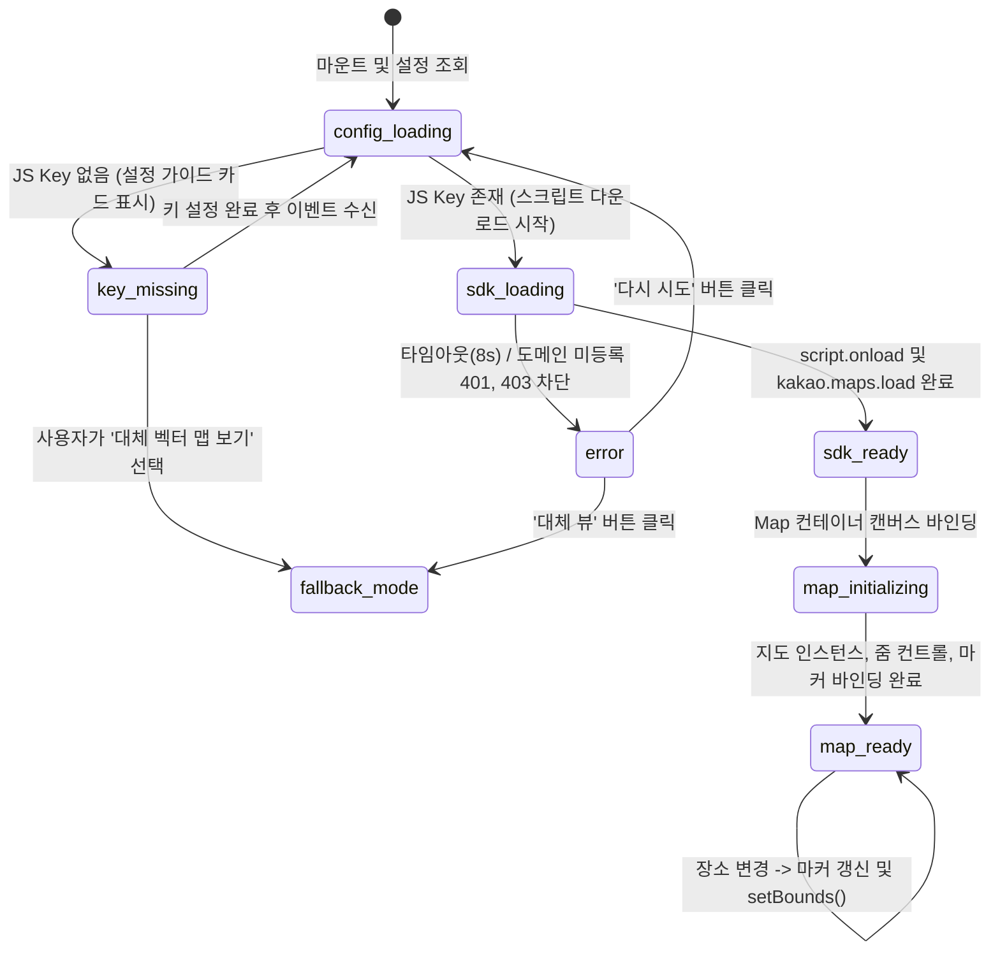

# Kakao Maps 연동 아키텍처 및 구현 명세서 (KAKAO_MAP_IMPLEMENTATION)

## 1. 시스템 개요
본 문서는 AI 로컬 어시스턴트의 **Kakao Maps Web SDK v2** 연동 아키텍처, 브라우저 스크립트 로딩 수명주기, 키 관리 및 실시간 동기화, `ResizeObserver` 기반의 레이아웃 재계산 및 마커 렌더링 명세를 기술합니다.

---

## 2. 7단계 지도 수명주기 상태 머신 (`MapSdkLifecycle`)

`KakaoMapView.tsx`는 다음 상태 머신에 따라 예측 가능하게 동작합니다.



### 각 상태별 렌더링 전략:
1. `config_loading`: 스켈레톤 로딩 인디케이터 ("지도 API 설정 확인 중...")
2. `key_missing`: 키 등록 안내 패널 (현재 실행 Origin 표시, 도메인 원클릭 복사, 설정 열기 CTA, 대체 벡터 맵 보기 CTA)
3. `sdk_loading`: 카카오 공식 엔진 로딩 인디케이터 ("카카오 지도 SDK 스크립트 로드 중...")
4. `sdk_ready` & `map_initializing`: DOM 마운트 대기 및 캔버스 할당
5. `map_ready`: 실제 도로/건물/지명 지도 캔버스 + 커스텀 나침반 중심 버튼 + 줌 컨트롤 + 에메랄드 정식 연동 배지 + 안전한 DOM InfoWindow
6. `error`: 진단 체크리스트 (도메인 등록 여부, 카카오맵 활성화 설정 ON 여부) + 다시 시도 / 설정 열기 CTA

---

## 3. 핵심 모듈별 구현 세부 사항

### 3-1. Next.js 프록시 리라이트 (`frontend/next.config.ts`)
```ts
const nextConfig: NextConfig = {
  turbopack: { root: path.resolve(__dirname) },
  async rewrites() {
    return [
      {
        source: "/api/:path*",
        destination: "http://127.0.0.1:8000/api/:path*",
      },
    ];
  },
};
```
- 브라우저가 호출하는 `/api/settings/public-map-config`를 Next.js 서버가 백엔드로 프록시하여 포트 불일치 및 CORS를 완벽하게 회피합니다.

### 3-2. 안전한 비동기 스크립트 로더 (`KakaoMapView.tsx`)
```tsx
const script = document.createElement("script");
script.id = "kakao-map-sdk";
script.src = `https://dapi.kakao.com/v2/maps/sdk.js?appkey=${activeJsKey}&autoload=false&libraries=services`;
script.async = true;

script.onload = () => {
  if (window.kakao && window.kakao.maps) {
    window.kakao.maps.load(() => {
      setLifecycle("sdk_ready");
    });
  }
};
script.onerror = () => {
  setErrorMessage("카카오맵 SDK 스크립트 다운로드 차단됨");
  setLifecycle("error");
};
```
- `autoload=false` 옵션을 통해 SDK가 다운로드된 후 명시적으로 `window.kakao.maps.load(callback)`을 호출하여 안전하게 초기화합니다.
- 8초 타임아웃 타이머를 배치하여 네트워크 정체 시 영구 대기 상태를 방지합니다.

### 3-3. 레이아웃 붕괴 방지 (`ResizeObserver` & `relayout`)
```tsx
useEffect(() => {
  if (!mapContainerRef.current || !kakaoMapRef.current) return;

  const observer = new ResizeObserver((entries) => {
    for (const entry of entries) {
      if (entry.contentRect.width > 0 && entry.contentRect.height > 0) {
        kakaoMapRef.current.relayout();
        // 현재 선택된 장소 또는 자치구 중심점으로 위치 재보정
        const dc = DISTRICT_DETAILS[selectedDistrict]?.center;
        if (dc) {
          kakaoMapRef.current.setCenter(new window.kakao.maps.LatLng(dc.lat, dc.lng));
        }
      }
    }
  });

  observer.observe(mapContainerRef.current);
  return () => observer.disconnect();
}, [selectedDistrict]);
```
- 모바일에서 '지도' 탭으로 전환되거나 데스크톱에서 우측 패널이 확장될 때 컨테이너의 실제 치수를 감지하여 `relayout()`을 즉시 호출함으로써 회색 빈 타일 현상을 원천 방지합니다.

### 3-4. 자치구 변경 시 인스턴스 재생성 없는 `panTo()`
```tsx
useEffect(() => {
  if (lifecycle !== "map_ready" || !kakaoMapRef.current || !window.kakao?.maps) return;
  const dc = DISTRICT_DETAILS[selectedDistrict]?.center;
  if (dc) {
    kakaoMapRef.current.panTo(new window.kakao.maps.LatLng(dc.lat, dc.lng));
  }
}, [selectedDistrict, lifecycle]);
```
- 자치구 변경 시 전체 Map 인스턴스를 파괴하지 않고 부드러운 패닝(`panTo`)으로 이동하여 GPU 메모리 낭비와 깜빡임을 제거했습니다.

### 3-5. 브라우저 실시간 SDK 검증 (`SettingsModal.tsx`)
```tsx
const testScript = document.createElement("script");
testScript.src = `https://dapi.kakao.com/v2/maps/sdk.js?appkey=${targetKey}&autoload=false`;
testScript.onload = () => {
  if (window.kakao?.maps) {
    // 도메인 및 키 유효성 확인 성공
    setKakaoJsSdkVerified(true);
  }
};
testScript.onerror = () => {
  // 도메인 미등록 또는 키 오류 확인
  setKakaoJsSdkVerified(false);
};
```
- 카카오 개발자 센터의 도메인 승인 규칙에 맞추어 실제 브라우저에서 스크립트 수신을 시도함으로써, 사용자가 도메인을 등록하지 않았거나 잘못된 키를 입력했을 때 즉시 구체적인 진단 메시지를 제공합니다.
