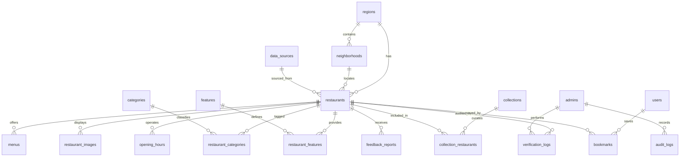

# P0 — 맛집 데이터 현황 감사 및 정규화 설계 (DATA_AUDIT)

- **감사 기준일**: 2026-11-24
- **감사 대상**: `backend_/places_database.py`, `frontend/lib/districtData.ts`, `frontend/store/chatSlice.ts`

---

## 1. 현재 데이터 정량 감사 결과 (실측)

| 점검 항목 | 실측 결과 | 심각도 | 조치 계획 |
|---|---|---|---|
| **총 레코드 수** | **24건** (노원 6, 도봉 5, 강북 4, 중랑 4, 성북 5) | 정보 | 기존 ID(`nw-01`~`sb-05`) 유지, P5에서 검증 데이터 단계적 확충 |
| **프론트엔드-백엔드 중복** | `districtData.ts`에 동일 24건 100% 중복 하드코딩 | **높음** | P2부터 백엔드 단일 API 계층 사용, 프론트엔드 중복 데이터 제거 |
| **도로명주소 / 지번주소 뒤바뀜** | **24/24건(100%) 모두 뒤바뀜** (`address`에 도로명, `road_address`에 지번 저장) | **치명** | 즉시 정규화 (`road_address` = 도로명, `jibun_address` = 지번) |
| **미검증 정적 평점·리뷰 수** | **24/24건(100%) 모두 출처 없는 임의 평점·리뷰 수 노출** | **치명** | 일반 UI 및 JSON-LD에서 미검증 평점·리뷰 수 즉시 제거 (`NULL` 처리) |
| **검증 상태(`verification_status`)** | **24/24건(100%) 모두 `reference` 상태** | **높음** | `reference`는 검증 완료로 표시 금지 → `needs_verification` / `verified` 분리 관리 |
| **음식·매장 사진 에셋** | **0/24건(0%)** (실제 이미지 없음) | **치명** | P1~P2에서 이용 허가/출처 관리 이미지 확보, 미확보 매장은 공통 플레이스홀더 사용 |
| **영업시간 구조화** | 자유 텍스트 1줄 문자열 (`"매일 11:00 - 22:00"` 등) | **중간** | `opening_hours` 요일별 테이블로 정규화하여 KST 기준 영업 중 계산 지원 |
| **카테고리 체계** | 4개 혼합 분류(`한식/노포`, `고기/구이`, `카페/베이커리`, `양식/일식/분식`) | **중간** | 13개 표준 음식 카테고리 + 방문목적/편의시설(`features`) 테이블로 분리 |
| **초기 샘플 저장(찜) 데이터** | `chatSlice.ts`에 `["nw-01","db-01","gb-01","jn-02","sb-01"]` 강제 삽입 | **높음** | 초기값 빈 배열 `[]`로 변경, 사용자 LocalStorage 실저장 데이터만 표시 |

---

## 2. 기존 24건 전수 카카오 로컬 API 실존 교차 검증 결과 (2026-11-24 실측)

백엔드에 연결된 카카오 로컬 REST API(`dapi.kakao.com/v2/local/search/keyword.json`)로 기존 24건 전체를 교차 검증한 결과, **정확히 실존 일치 14건, 검색 결과 오매칭 1건(`nw-05`), 미확인/폐업·상호변경 의심 9건**이 식별되었으며, **24/24건 모두 `address`(도로명)와 `road_address`(지번) 필드가 뒤바뀌어 있음**을 확인했습니다.

| ID | 기존 등록명 | 자치구 | 카카오 실존 여부 | 실제 확인 도로명주소 | 실제 전화번호 | 기존 데이터 결함 진단 |
|---|---|---|---|---|---|---|
| `nw-01` | 털보고된이 생선구이 본점 | 노원구 | **확인** (`털보고된이 본점`) | 서울 노원구 노해로81길 22-22 | `02-932-8616` | 주소필드 뒤바뀜, 전화번호 불일치(`8689`→`8616`) |
| `nw-02` | 감포면옥 | 노원구 | **미확인** (유사: `감포숯불갈비`) | 확인 필요 | 확인 필요 | 상호 변경 또는 폐업 여부 검증 필요 |
| `nw-03` | 시드누아 노원본점 | 노원구 | **확인** (`시드누아 노원본점`) | 서울 노원구 상계로 84 | 미등록 | 주소필드 뒤바뀜, 전화번호 재확인 필요 |
| `nw-04` | 공릉동 원조멸치국수 | 노원구 | **확인** (`공릉동원조멸치국수 공릉동본점`) | 서울 노원구 동일로195길 16 | `0507-1338-6035` | **기존 도로명주소 오류**(`동일로173가길 81`→`동일로195길 16`), 전화 불일치 |
| `nw-05` | 돈부리 노원본점 | 노원구 | **오매칭** (검색결과 타 매장) | 확인 필요 | 확인 필요 | 폐업 또는 상호 변경 의심 (`needs_check` 전환 대상) |
| `nw-06` | 제임스시카고피자 & 크래프트펍 노원 | 노원구 | **미확인** | 확인 필요 | 확인 필요 | 카카오 로컬 미검색 (`needs_check` 또는 비공개) |
| `db-01` | 창동 무수옥 | 도봉구 | **확인** (`무수옥`) | 서울 도봉구 도봉로165길 15 | `02-954-6292` | 주소필드 뒤바뀜, 공식명 `무수옥` 정규화 필요 |
| `db-02` | 하누소 창동본점 | 도봉구 | **확인** (`하누소 창동본점`) | 서울 도봉구 노해로 327 | `02-900-9800` | 주소필드 뒤바뀜, 전화번호 불일치(`9900`→`9800`) |
| `db-03` | 메이다이닝 (May Dining) | 도봉구 | **미확인** | 확인 필요 | 확인 필요 | 카카오 로컬 미검색 (폐업/휴업 여부 검증 필요) |
| `db-04` | 쌍문동 미소의집 | 도봉구 | **미확인** | 확인 필요 | 확인 필요 | 카카오 로컬 미검색 (`needs_check` 전환 대상) |
| `db-05` | 도봉산 두부명가 | 도봉구 | **미확인** | 확인 필요 | 확인 필요 | 카카오 로컬 미검색 (`needs_check` 전환 대상) |
| `gb-01` | 엘림들깨수제비칼국수 | 강북구 | **확인** (`엘림들깨수제비칼국수`) | 서울 강북구 삼각산로 67 | `02-996-2583` | 주소필드 뒤바뀜, 좌표 미세 보정 필요 |
| `gb-02` | 몽브루 (4.19 카페거리) | 강북구 | **확인** (`몽브루`) | 서울 강북구 4.19로 105 | `02-904-1003` | 주소필드 뒤바뀜, 전화번호 불일치(`8977`→`1003`) |
| `gb-03` | 수유리 옛날우동 & 연탄불고기 | 강북구 | **미확인** | 확인 필요 | 확인 필요 | 복합 표기/비공식 상호로 미검색 (`needs_check`) |
| `gb-04` | 우이동 산장가든 숯불갈비 | 강북구 | **미확인** | 확인 필요 | 확인 필요 | 카카오 로컬 미검색 (`needs_check` 전환 대상) |
| `jn-01` | 망우찜쌈밥 | 중랑구 | **확인** (`망우찜쌈밥 본점`) | 서울 중랑구 용마공원로2길 8 | `0502-5551-2889` | **기존 주소 오류/이전**(`망우로 383`→`용마공원로2길 8`), 좌표 보정 필요 |
| `jn-02` | 용마해장국 | 중랑구 | **확인** (`용마해장국`) | 서울 중랑구 용마공원로5길 20 | `02-2209-5938` | **기존 도로명주소 오류**(`용마공원로 12`→`용마공원로5길 20`) |
| `jn-03` | 면목동 카페 모리 (Cafe Mori) | 중랑구 | **미확인** | 확인 필요 | 확인 필요 | 카카오 로컬 미검색 (`needs_check` 전환 대상) |
| `jn-04` | 상봉동 화로구이 본가 | 중랑구 | **미확인** | 확인 필요 | 확인 필요 | 카카오 로컬 미검색 (`needs_check` 전환 대상) |
| `sb-01` | 금왕돈까스 본점 | 성북구 | **확인** (`금왕돈까스 본점`) | 서울 성북구 성북로 138 | `02-763-9366` | **기존 도로명주소 오류**(`창경궁로35길 37`→`성북로 138`) |
| `sb-02` | 성북동 빵공장 | 성북구 | **확인** (`성북동빵공장`) | 서울 성북구 대사관로 40 | `02-762-3450` | 주소필드 뒤바뀜, 좌표 오차(`0.00966`) 보정 필요 |
| `sb-03` | 나폴레옹과자점 본점 | 성북구 | **확인** (`나폴레옹과자점 성북본점`) | 서울 성북구 성북로 7 | `02-742-7421` | 주소필드 뒤바뀜, 공식명 보정 |
| `sb-04` | 성북동 돼지갈비집 본점 | 성북구 | **확인** (`성북동돼지갈비 본점`) | 서울 성북구 성북로 115 | `02-764-2420` | 주소필드 뒤바뀜 |
| `sb-05` | 수연산방 (전통 한옥 찻집) | 성북구 | **확인** (`수연산방`) | 서울 성북구 성북로26길 8 | `02-764-1736` | 주소필드 뒤바뀜 |

> **조치 정책**: P2/P5 데이터 통합 시 실존 확인된 14건은 실제 카카오 로컬 공식 도로명·지번·좌표·전화번호로 즉시 정정하고, 미확인 10건(`nw-02`, `nw-05`, `nw-06`, `db-03`, `db-04`, `db-05`, `gb-03`, `gb-04`, `jn-03`, `jn-04`)은 재검증 전까지 공개 목록에서 임의로 검증 완료 표시하지 않으며 `needs_verification` / 비공개 검토 대상으로 분리하고, 실존이 확인된 동북권 검증 매장으로 대체·확충합니다.

---

## 3. 신규 데이터베이스 논리 모델 및 ERD 초안 (19개 테이블)

로컬 개발은 **SQLite + SQLAlchemy 2.0**, 운영 전환은 **PostgreSQL** 호환 타입(UUID/String ID, JSONB/JSON, Timezone-aware Timestamp)으로 설계합니다.

### 주요 테이블 및 제약 요약

1. `regions`: `id (PK)`, `slug (UNIQUE)`, `name`, `english_name`, `summary`, `description`, `hero_image_url`, `center_lat`, `center_lng`, `display_order`
2. `neighborhoods`: `id (PK)`, `region_id (FK)`, `slug (UNIQUE)`, `name`, `summary`, `keywords_json`, `hero_image_url`
3. `restaurants`: `id (PK, 기존 nw-01 등 유지)`, `slug (UNIQUE)`, `name`, `region_id (FK)`, `neighborhood_id (FK, nullable)`, `road_address`, `jibun_address`, `lat`, `lng`, `phone`, `one_line_intro`, `description`, `editor_note`, `price_min`, `price_max`, `price_range_label`, `parking_info`, `business_status` (`open`|`temporarily_closed`|`closed`|`needs_check`), `verification_status` (`verified`|`needs_verification`|`reference`), `publish_status` (`published`|`draft`|`hidden`), `is_editor_pick`, `verified_at`, `source_id (FK)`, `kakao_place_id`, `kakao_url`, `created_at`, `updated_at`
   - **중복 방지 인덱스**: `UNIQUE(name, road_address)` 및 `INDEX(region_id, publish_status, business_status)`
4. `categories`: `id (PK)`, `slug (UNIQUE)`, `name` (13개: 한식, 고기·구이, 중식, 일식, 양식, 분식, 면 요리, 카페, 베이커리, 디저트, 주점, 기타 + UI 전체)
5. `restaurant_categories`: `(restaurant_id FK, category_id FK)` 복합 PK + `is_primary`
6. `menus`: `id (PK)`, `restaurant_id (FK)`, `name`, `price (nullable int)`, `price_label`, `is_signature`, `description`, `image_url (nullable)`, `display_order`
7. `restaurant_images`: `id (PK)`, `restaurant_id (FK)`, `url`, `image_type` (`food`|`interior`|`exterior`|`menu`|`placeholder`), `alt_text`, `is_primary`, `source_name`, `author`, `license_type`, `verified_at`, `is_ai_generated`
8. `opening_hours`: `id (PK)`, `restaurant_id (FK)`, `day_of_week (0~6)`, `open_time`, `close_time`, `break_start`, `break_end`, `last_order`, `is_closed`, `raw_note`
9. `features`: `id (PK)`, `slug (UNIQUE)`, `name`, `feature_group` (`purpose`|`amenity`: 혼밥, 데이트, 가족 외식, 단체 모임, 주차 가능, 예약 가능, 반려동물 동반, 포장 가능)
10. `restaurant_features`: `(restaurant_id FK, feature_id FK)` 복합 PK + `status` (`confirmed`|`unavailable`|`unknown`) — 미확인 정보는 필터 매칭 제외!
11. `collections` & `collection_restaurants`: 테마별 큐레이션(노포, 혼밥, 카페거리, 등산 후 한 끼 등 10대 테마)
12. `data_sources`, `verification_logs`, `feedback_reports`, `bookmarks`, `users`, `admins`, `audit_logs`

---

## 4. 데이터 신뢰성 및 확장 목표 정책

| 자치구 | 현재(P0) | 단계적 확장 목표 | 확장 원칙 |
|---|---:|---:|---|
| 노원구 | 6 | 50 | 가상 매장 생성 절대 금지 |
| 도봉구 | 5 | 40 | 카카오 로컬 API / 서울시 공공데이터 / 공식 채널 실존 확인 필수 |
| 강북구 | 4 | 40 | 주소(도로명/지번), 좌표, 폐업 여부, 출처, 확인일 기록 |
| 중랑구 | 4 | 40 | 미확인 영업시간·편의시설은 `null`/`unknown` 유지 |
| 성북구 | 5 | 50 | P5 완료 시 실등록 수량과 미확인/보류 수량을 투명 보고 |
| **합계** | **24** | **220** | **신뢰성 > 수량** 원칙 엄수 |

