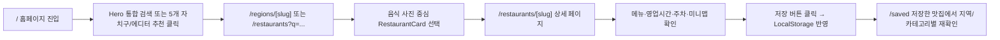
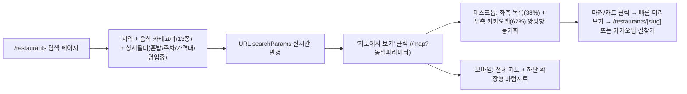
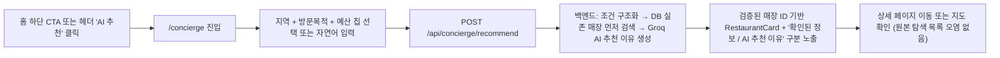
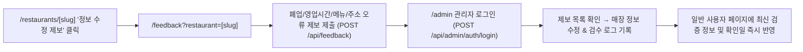

# P0 — 핵심 사용자 흐름 및 인터랙션 설계 (UX_FLOW)

---

## 1. 핵심 페르소나 및 진입 시나리오

1. **동네 주민 / 직장인 (일상 탐색)**: "오늘 공릉동에서 점심으로 1만 원대 혼밥할 곳 없나?"
2. **주말 나들이 / 데이트 방문객 (테마 탐색)**: "성북동이나 4.19 카페거리에서 분위기 좋은 베이커리·한식당 찾고 싶어."
3. **등산객 / 가족 모임 기획자 (조건 탐색)**: "도봉산 등산 후 주차 편하고 부모님 모시기 좋은 노포 찾자."
4. **서비스 운영 관리자 (콘텐츠·데이터 검수)**: "신규 제보 확인, 영업시간 업데이트, API 키 설정 점검."

---

## 2. 주요 사용자 여정 (User Journeys)

### Flow 1: 홈페이지 발견 → 상세 확인 → 저장

### Flow 2: 조건 기반 정밀 검색 → 지도 연동 탐색

### Flow 3: 자연어 AI 미식 추천 컨시어지

### Flow 4: 정보 수정 제보 → 관리자 검수 및 반영

---

## 3. 화면 유형별 레이아웃 분리 원칙

| 페이지 그룹 | 레이아웃 유형 | 핵심 UX 규칙 |
|---|---|---|
| `/`, `/regions/*`, `/collections/*` | **A. 로컬 미식 매거진형** | 상단 단일 헤더, 최대 너비 `1280~1440px`, 넉넉한 섹션 간격(`64~96px`), 비대칭 에디토리얼 리듬, 지도·채팅 상시 노출 금지 |
| `/restaurants`, `/saved` | **B. 맛집 검색 플랫폼형** | 상단 검색바 + 1차 필터(지역/카테고리/정렬/지도보기) + 상세필터 모달/바텀시트, 3~4열(데스크톱)/1~2열(모바일) 균일 카드 그리드 |
| `/map` | **C. 지도 기반 탐색형** | 데스크톱 좌측 35~40% 목록 + 우측 60~65% 지도, 모바일 풀스크린 지도 + 드래그/토글 바텀시트 |
| `/concierge` | **미니멀 컨시어지형** | 중앙 집중 검색창 + 조건 칩 + 결과 카드, 이전 대화 기록은 접이식 드로어 |
| `/admin` | **업무 효율형 관리 UI** | 일반 사용자 헤더와 완전 분리된 관리자 전용 레이아웃, 서버 인증 필수 |

---

## 4. 모바일 UX 및 접근성 핵심 규칙

- **모바일 하단 내비게이션(5탭)**: `홈`, `탐색`, `지도`, `AI 추천`, `저장` (터치 타겟 최소 `44×44px`, `env(safe-area-inset-bottom)` 반영).
- **320px 초소형 해상도 방어**: 헤더 텍스트 축약/아이콘 전환, 1열 카드 폴백, 가로 스크롤(`scrollWidth > innerWidth`) 0건 보장.
- **키보드 및 스크린리더**: Skip-to-content 링크, 명확한 `focus-visible` 아웃라인(`#283A30`/`#B65C37`), 모달·드로어 포커스 트랩 및 `Esc` 닫기, `prefers-reduced-motion` 준수.

